# Kee+

A self-hosted notes and to-do app in the spirit of Google Keep. It looks and
feels like Keep, adds what Keep is missing (categories with a look you make
yourself, sub-categories, sorting) and keeps your notes on your own machine.
It runs as one small container, for example on a NAS, and is built to make
adding a note as fast as possible, on a phone or in a desktop browser.

> **Built with [Claude Code](https://claude.com/claude-code).** The code,
> the screenshots and these docs were written by Claude Code, Anthropic's AI
> coding agent, directed and reviewed by a human. See
> [How it was built](#how-it-was-built).

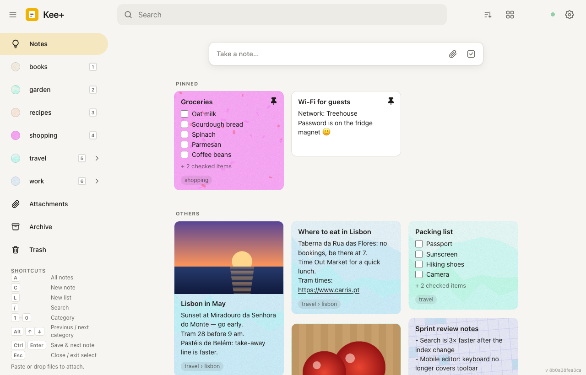

<p>
  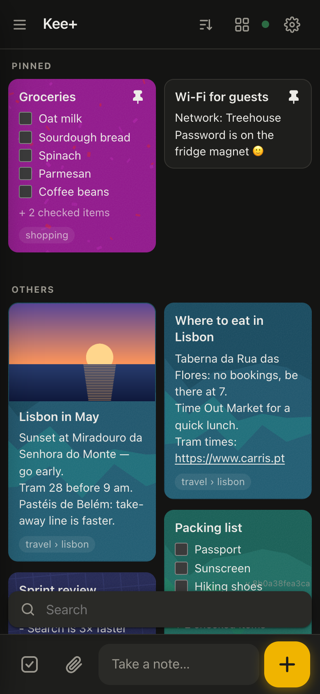
  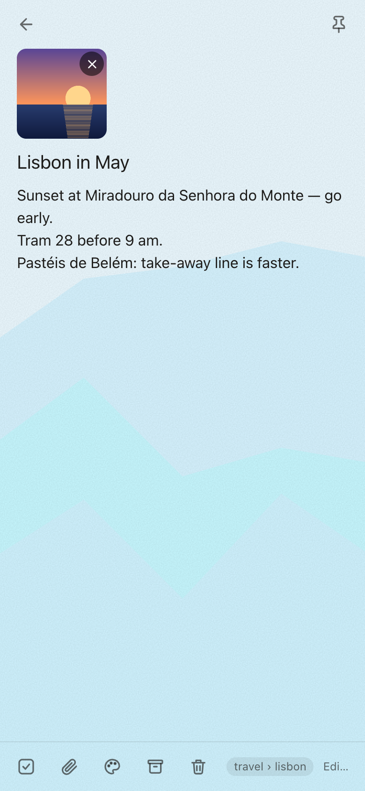
  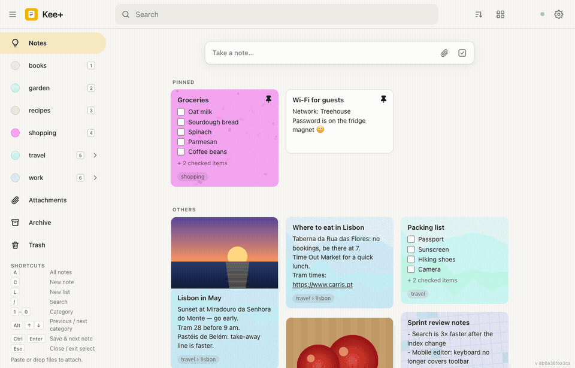
</p>

All screenshots show made-up demo data (see [Screenshots and demo data](#screenshots-and-demo-data)).

## What's different from Google Keep

| | Google Keep | Kee+ |
| --- | --- | --- |
| Where notes live | Google's servers, Google account required | Your own server, one SQLite file; no account, no tracking |
| Backgrounds | A dozen colours and a few fixed pictures | Any word becomes a category: a generated pattern you can tune |
| Sorting | Manual drag order only | Date created, last edited or title, optionally grouped by category |
| Organising | Labels | Categories and sub-categories with their own look, sidebar view and drag-and-drop filing |
| Card size | Grid or list | Zoom slider from small to large cards (1–3 columns on phones) |
| Attachments | Images and drawings | Images and PDFs, plus an Attachments gallery |
| Quick capture | Click, type, click away | On desktop the composer is focused on load; Ctrl+Enter saves and starts the next note |
| Keyboard | A few shortcuts | Every category has a key (1–9, 0, then letters); Alt+↑/↓ steps through categories; Ctrl+Z undoes any delete |
| Selection | Select notes one by one | Also drag a box around notes with the mouse |
| Moving over | – | One-click import of a Google Takeout export, images, labels and dates included |

### Categories from a word

Type any word in the palette and the note gets a background drawn from it:
*ocean* gives waves, *garden* leaves, *recipes* warm stripes, *music* its own
colours. Known words come from a keyword table; any other word hashes to its
own colours and motifs. Everything is generated as SVG in the browser: no
network, no AI, no image files. Every note of a word looks the same on every
device, and hue, saturation, brightness and intensity can be tuned per
category in Settings.

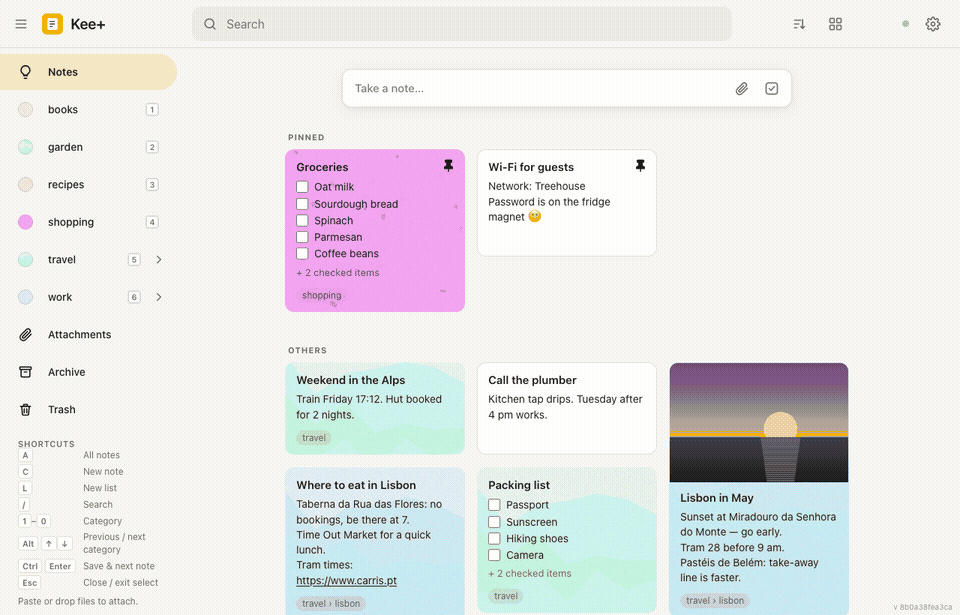

<p>
  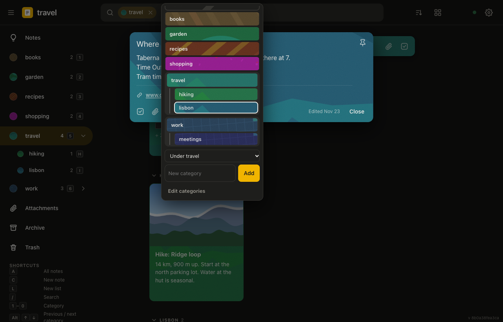
  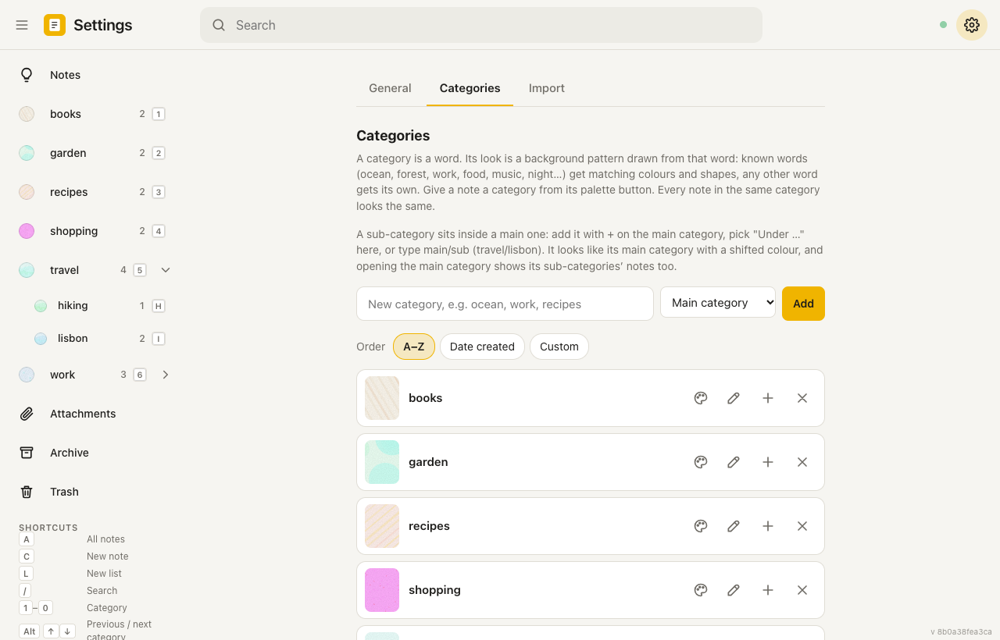
</p>

### Sorting and grouping

Sort by date created, last edited or title, in either direction. "Group by
category" (on by default) works with any of these: the board gets one
section per category, pinned notes first in each, the rest sorted inside;
click a heading to fold a group away. The zoom slider
sets the card size. Sort, zoom and folded groups are remembered per device.

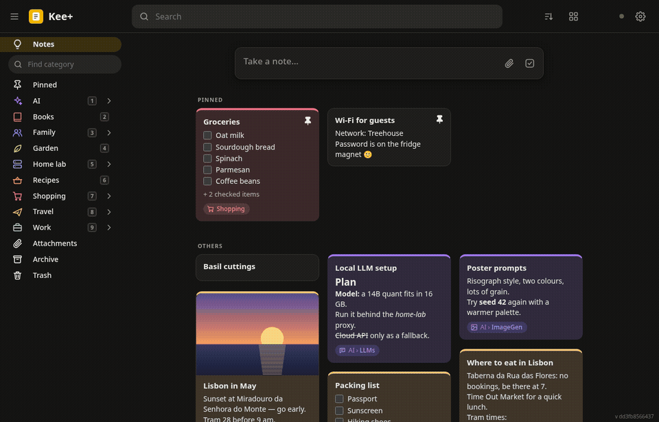

### Categories

Each category is an entry in the sidebar that shows only its notes. A note
written there gets the category automatically. On desktop, drag a note (or
the whole selection) onto a sidebar entry to file it; one Undo puts it back.
Categories can be listed A–Z, by date created or in your own order.

- **Sub-categories**, one level deep: type `travel/lisbon`, or pick a main
  category in the "Under …" menu. A sub draws its main category's pattern
  in its own colour, and the main category's view includes its subs' notes,
  grouped by sub. In the sidebar, main categories fold open and closed;
  holding dragged notes over a closed one opens it for the drop.
- **Sidebar at a glance:** each entry shows its shortcut key, its note
  count, or both. Empty categories fade, or hide until you need them as a
  drop target. Drag the sidebar's edge to make it wider.
- **Search inside a category:** in a category view, search finds only that
  category's notes, shown as a chip in the search box. Remove the chip to
  widen the search to every note.
- **Rename** a category and every note that has it follows, with one Undo.

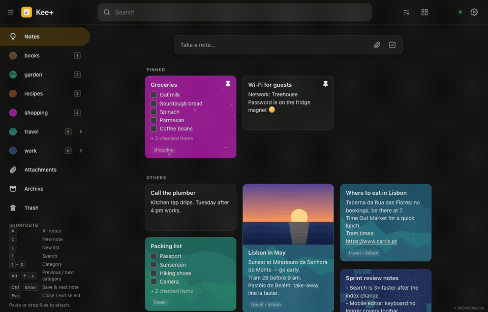

<p>
  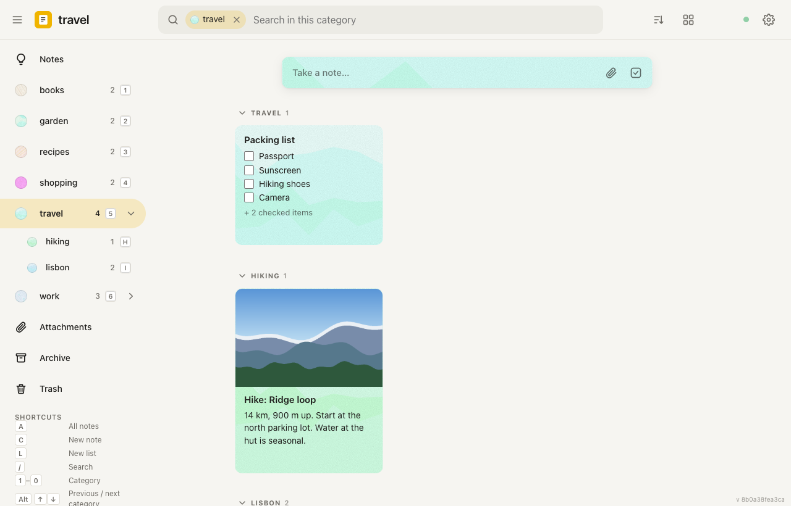
  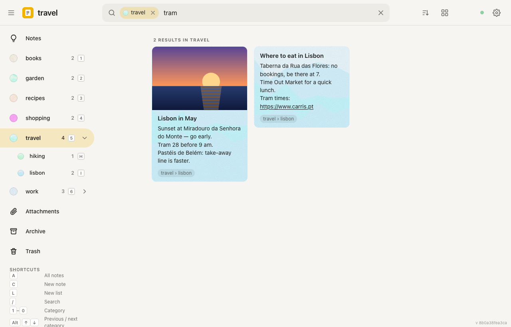
</p>

### Keyboard first

On desktop the composer has focus when the page opens: type, then
Ctrl+Enter saves and starts the next note. Every category has a key (1–9
and 0 for the first ten, then a letter from its name), shown next to it in
the sidebar. Alt+↑/↓ steps through Notes and every category, subs
included. A goes back to all notes, C or N starts a note, L a list, / jumps
to search, Esc closes.

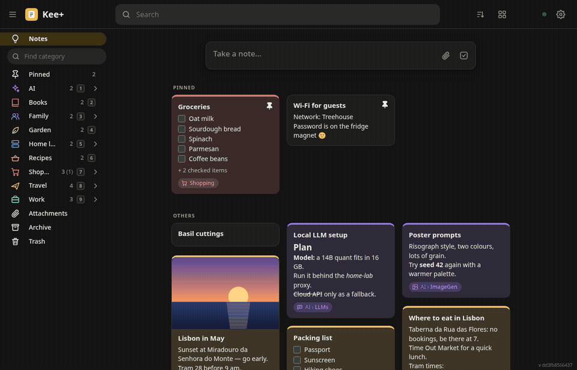

### Also

- Text notes and checklists, pinning, archive, Trash with a 7-day purge.
  Destructive actions show an Undo toast (Ctrl+Z works too) instead of a
  confirm dialog.
- Offline first: the app renders from a local copy and syncs in the
  background, so it opens instantly and keeps working without a connection.
  Changes sync between devices; the newest edit of a note wins.
- Paste, drop or pick images and PDFs. Images are shrunk in the browser
  before upload.
- Links in titles, text and checklists are clickable, LAN addresses like
  `http://nas:5000` included.
- Per device: start new notes in the title or the body, text size and
  sidebar spacing, where notifications show and for how long.
- Light and dark mode; installable as a home-screen app (PWA) on iOS and
  Android.
- No build step, no framework, no dependencies: Python standard library on
  the server, vanilla JS in the browser.

### What Keep has and Kee+ doesn't

Reminders, sharing notes with other people, drawings, voice notes, text
recognition in images, native apps and a login. Kee+ is a single-user app
for a trusted network.

<p>
  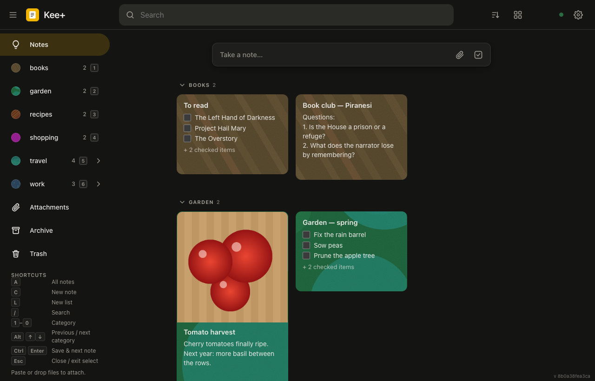
  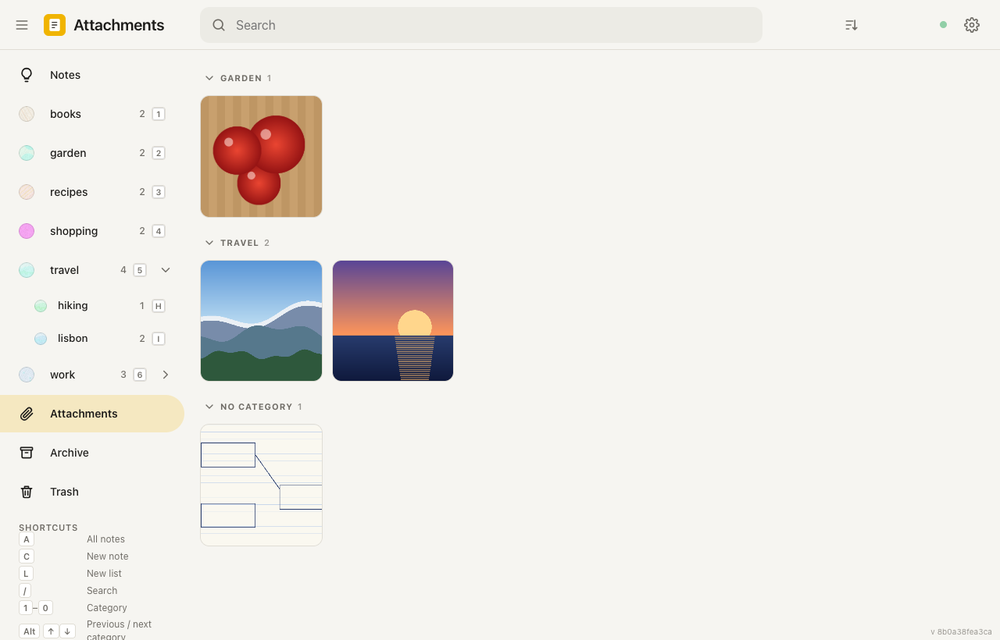
</p>

## Security

**There is no login.** Anyone who can reach the port can read and edit every
note and upload files (within the quota). Notes and attachments are stored
unencrypted in `./data`.

`compose.yaml` therefore binds the port to `127.0.0.1` only. Reach it through
a proxy on the same host; the recommended one is `tailscale serve`, which
adds HTTPS and limits access to your tailnet (with ACLs, to your own
devices). See [Access over Tailscale](#access-over-tailscale). To open it
to your LAN instead, set `KEE_BIND=0.0.0.0` in `.env`: then every device on
the network can read every note. Never publish the port to the internet.

## Quick start

With Docker:

```sh
git clone <repo-url> kee-plus
cd kee-plus
docker compose up -d --build
```

Then open `http://localhost:8090` on that machine. For your other devices,
see [Access over Tailscale](#access-over-tailscale). Notes and attachments
are stored in `./data`.

Without Docker (Python 3; the container uses 3.13):

```sh
MYNOTES_DB=./data/notes.db PORT=8080 python3 server.py
```

To add it to an iPhone home screen, open it in Safari, then Share → Add to
Home Screen. For a NAS setup with Tailscale access, see
[docs/deploy-synology.md](docs/deploy-synology.md).

## Access over Tailscale

The server only listens on `127.0.0.1`, so other devices reach it through
[Tailscale](https://tailscale.com): `tailscale serve` on the server host
gives it an HTTPS address that only your tailnet can open. Every device
that uses Kee+ needs Tailscale running, at home too; on the same network
Tailscale connects directly, so traffic stays on the LAN.

1. **Install Tailscale** on the server host and on every device (iPhone,
   Mac, …), signed in to the same tailnet. On phones, turn on VPN On
   Demand in the Tailscale app so it stays connected.
2. **Turn on HTTPS.** In the [admin console](https://login.tailscale.com/admin),
   open **DNS** and enable **MagicDNS** and **HTTPS Certificates**.
3. **Find the host's name.** On the **Machines** tab, or with
   `tailscale status`: it looks like `<machine>.<tailnet>.ts.net`.
4. **Tell Kee+ its name.** Create `.env` next to `compose.yaml` (it is
   ignored by git) and restart:

   ```sh
   echo MYNOTES_HOSTS=<machine>.<tailnet>.ts.net > .env
   docker compose up -d
   ```

   Without it, requests to that name get 421 (unknown host).
5. **Serve it on the tailnet.** On the host (on a Synology NAS the binary
   is `/var/packages/Tailscale/target/bin/tailscale`; run it with `sudo`):

   ```sh
   tailscale serve --bg 8090
   ```

   `--bg` keeps it across reboots; `tailscale serve status` shows it.
6. **Open** `https://<machine>.<tailnet>.ts.net`. The first request can take
   a few seconds while the certificate is issued.

**Limit who can reach it (optional).** By default every device in a tailnet
can reach every other. If only your own devices are in it, that's enough.
If you share the tailnet or the machine with other people, open **Access
controls** in the admin console (a JSON policy editor), replace the default
allow-all rule, check it on **Preview rules** and save:

```json
{
  "hosts": { "kee": "<host's 100.x.y.z Tailscale IP>" },
  "grants": [
    { "src": ["autogroup:member"], "dst": ["autogroup:self"], "ip": ["*"] },
    { "src": ["<your-login>"], "dst": ["kee"], "ip": ["tcp:443", "tcp:22"] }
  ]
}
```

`tcp:443` is Kee+; keep `tcp:22` if you SSH to the host over Tailscale, or
you lock yourself out (add any other port you use, such as 5000–5001 for
DSM). The console keeps the policy's history if you need to roll back.

**Moving from an older `http://<ip>:8090` setup:** every address keeps its
own local copy in the browser. Open the old address on each device and let
it sync before you switch, then add the new address to the home screen
again.

## How it works

- `server.py` is a small Python HTTP server (standard library only, on
  `python:3.13-alpine`). It serves the front end from `public/` and a JSON
  API:
  - `POST /api/sync` exchanges changed notes with the client.
  - `GET /api/notes?since=0` returns every note (export and debugging).
  - `PUT /api/files/<id>` and `PUT /api/files/<id>/thumb` upload an
    attachment and its thumbnail; `GET` on the same paths serves them.
  - `GET /api/files` lists the metadata of every stored file.
- Notes are stored in SQLite at `/data/notes.db` inside the container.
- Attachments (images and PDFs) are stored as files in `/data/files/`,
  with their metadata in the same SQLite database. `files.py` handles them.
  Images are shrunk to 2000 px on the long edge in the browser before
  upload and get a 480 px thumbnail; originals are not kept.
- When a note is deleted forever (Delete forever, Empty Trash, or the
  7-day Trash purge), its files are deleted 10 minutes later, unless
  another note still uses them or Undo brings the note back. Moving a note
  to Trash keeps its files, so Restore works.
- A file dropped from a note that still exists (removed by hand, or lost
  in an edit conflict) is kept for 30 days first. The cleanup runs at
  startup, every hour, and after each delete forever. Run it by hand with
  `python3 files.py --scan` (inside the container:
  `docker exec kee-plus python files.py --scan`).
- Open clients reload themselves after a deploy: every sync response
  carries a hash of the files in `public/`, and a client running older code
  reloads at its next sync.
- Design notes for contributors are in [CLAUDE.md](CLAUDE.md) and
  [docs/designs/](docs/designs/).

## Configuration

Environment variables:

| Variable | Default | Meaning |
| --- | --- | --- |
| `MYNOTES_DB` | `/data/notes.db` | SQLite database |
| `PORT` | `8080` | HTTP port inside the container |
| `MYNOTES_HOSTS` | empty | Extra host names the server answers to, comma-separated (e.g. a `*.ts.net` name). IP addresses and `localhost` always work; any other `Host` gets 421, which blocks DNS rebinding |
| `MYNOTES_FILES` | `files/` next to the database | Attachment folder |
| `MYNOTES_MAX_FILE_MB` | `20` | Largest single upload |
| `MYNOTES_QUOTA_MB` | `4096` | Total attachment storage; uploads are also refused when less than 1 GiB is free |
| `MYNOTES_FILE_GRACE_DAYS` | `30` | How long a file dropped from a live note is kept |
| `MYNOTES_PURGE_MINUTES` | `10` | How long the files of a note deleted forever are kept (covers Undo) |

`compose.yaml` publishes container port 8080 on host port 8090 on
`127.0.0.1`, or on `KEE_BIND` if set. It reads `KEE_BIND` and `MYNOTES_HOSTS`
from `.env` (git-ignored).

## Import from Google Keep

Export Keep with Google Takeout and unzip it. Open Settings (the cog at the top
right), go to the Import tab and choose the `Takeout/Keep` folder (on a phone, select all its files). Notes go
to the "imported" category with their images, lists, colours, pins, archive
state and dates; labels become #tags. Importing the same export again skips
what is already there.

## Backup and export

`notes.db` runs in WAL mode. A plain copy of `notes.db` and `notes.db-wal`
taken while the server writes can be inconsistent, so back up a snapshot
made with SQLite's online backup instead.

### Backup on the Synology NAS

Two DSM jobs:

1. **Task Scheduler**: a daily user-defined script, run as a user that
   may use Docker, scheduled before the Hyper Backup run. It writes a
   consistent copy to `data/backup/notes.db` while the app keeps running,
   and overwrites it each night:

   ```sh
   /usr/local/bin/docker exec kee-plus python -c "import os, sqlite3; os.makedirs('/data/backup', exist_ok=True); s=sqlite3.connect('/data/notes.db'); d=sqlite3.connect('/data/backup/notes.db'); s.backup(d); d.close(); s.close()"
   ```

   It depends on the container name `kee-plus` and the database path
   `/data/notes.db`. Update the task if either changes.

2. **Hyper Backup**: a daily task to any target (another NAS, a USB disk
   or a cloud drive), with versioning such as Smart Recycle. Back up the
   clone folder, for example `/docker/kee-plus`, excluding `.git/`,
   `docs/`, `public/` and `tools/`. It then holds `data/backup/notes.db`,
   `data/files/` and `compose.yaml`; the code is in git.

The live `data/notes.db*` files are in the Hyper Backup too, but they can be
inconsistent. Always restore from `data/backup/notes.db`.

### Restore

1. In Hyper Backup, restore `data/backup/notes.db` and `data/files/` from
   the version you want into a temporary folder.
2. Stop the app: `docker compose down` in the clone folder.
3. Replace `data/notes.db` with the restored `backup/notes.db`. Delete
   `data/notes.db-wal` and `data/notes.db-shm`. Replace `data/files/`.
4. Start it: `docker compose up -d`.

To test a backup without touching the live app, run the restored copy on
another port:
`MYNOTES_DB=/tmp/kee-restore/notes.db PORT=8765 python3 server.py`.

### Export

- `GET /api/notes?since=0` returns every note, tombstones included.
  Attachments appear only as metadata in each note's `files` array.
- `GET /api/files` returns the metadata of every stored file. The bytes are
  in `./data/files/` (`<id>` and `<id>.thumb`).

## Known risks

- **No login.** See [Security](#security).
- **Attachments can be lost in an edit conflict.** Sync is last-write-wins
  per note. If a device edits an older copy of a note that just got an
  attachment on another device, the newer write drops the reference, and
  the file is deleted 30 days later. `GET /api/files` lists files that are
  no longer referenced (`unreferenced_since` set) until then.
- **No rollback past the attachments release.** An older build treats
  image-only notes as empty and deletes them when they are opened and
  closed. Fix forward instead.
- **No service worker.** Served over plain HTTP the page is not a secure
  context; behind `tailscale serve` it is, but the app doesn't use one yet. The local copy in
  `localStorage` still gives an instant start.

## Screenshots and demo data

The screenshots are generated from made-up notes, never from a real
database. To regenerate them (needs Node 22+ and Chromium; `ffmpeg` for the
GIFs). The GIF scenes change the demo data, so start from an empty database
each time:

```sh
rm -rf /tmp/kee-demo && mkdir -p /tmp/kee-demo
MYNOTES_DB=/tmp/kee-demo/notes.db PORT=8765 python3 server.py   # in one shell
python3 tools/seed_demo.py http://localhost:8765                 # in another
node tools/screenshots.mjs http://localhost:8765
```

`seed_demo.py` refuses to write to a server that already has notes. The
screenshot script uses a fresh browser profile on its own port, so the
browser's stored notes are separate from any real instance. The demo
server is also handy for trying the app: open `http://localhost:8765`.

## How it was built

Kee+ was written with [Claude Code](https://claude.com/claude-code). A human
set the goals, used the app and decided what stays; Claude Code wrote the
server, the client, the demo data, the screenshot scripts and the
documentation.

[CLAUDE.md](CLAUDE.md) is the project memory Claude Code works from: the
design decisions, the browser gotchas that were hit and solved, and the
rules every change has to keep. It doubles as the most detailed technical
description of the app.

## License

[MIT](LICENSE)
